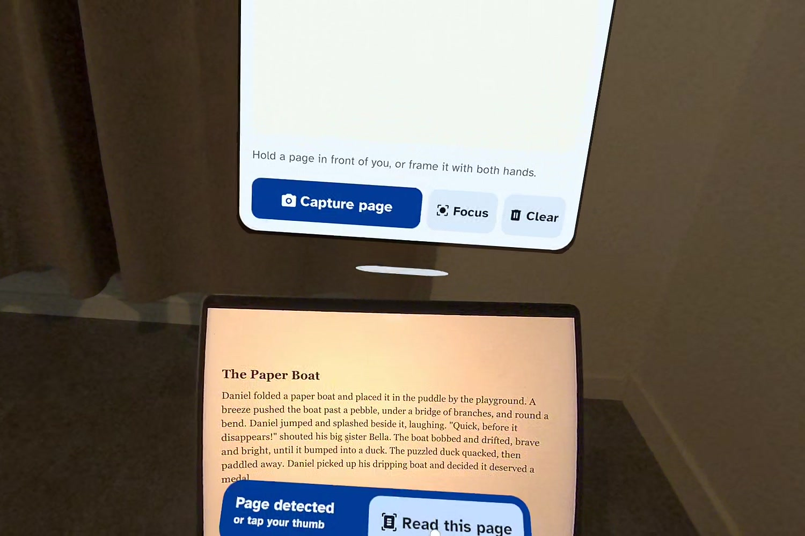
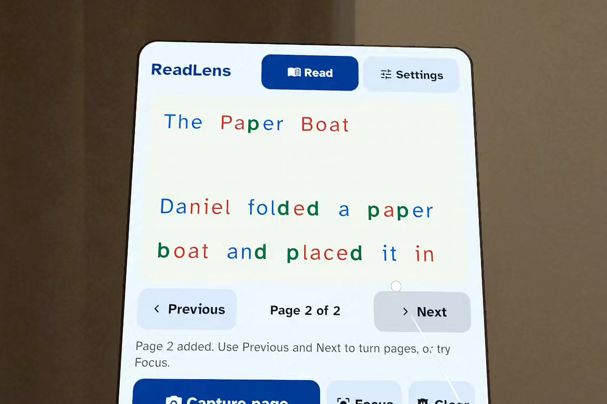

# ReadLens

**Every page can be readable.**

ReadLens is a mixed-reality reading aid for Meta Quest 3 and 3S. Hold up any text, on paper or on a screen, and read it
again in your own font, spacing and colors. It is built for children with dyslexia, and it is used with hands only.



Entry for the **Meta VR Start Developer Competition 2026** — track *Productivity*, division *New*.
Planned public release: **late December 2026**.

## Why

About 1 child in 14 has dyslexia: a 2022 meta-analysis of 58 studies found it in 7.1% of primary school children
([Yang et al., Brain Sciences](https://pmc.ncbi.nlm.nih.gov/articles/PMC8870220/)). Adapted pages help, with wider
spacing, larger type and the right colors, but they depend on a teacher who has the tools and the time to reprint each
document. ReadLens puts that adaptation in the child's hands, for any page.

It keeps the child *reading*. Reading a text aloud helps to get through a page, but it is not reading practice.

## What it does

| | |
| --- | --- |
| **Finds the text by itself** | The headset looks about once per second. When it sees readable text, a "Page detected" button appears right under the real page. |
| **One thumb tap reads it** | Tap your thumb on your index finger, or touch the button. Both hands can stay on the book. |
| **Your own reading profile** | Three fonts (OpenDyslexic, Atkinson Hyperlegible, classic), size, letter / word / line spacing, page and text colors, coloring by syllables (English and French), words or lines, and b / d / p / q highlighted. |
| **Pages like a book** | Each capture is a page. Swipe your thumb right for the next one, left for the previous one. Pages are kept between sessions. |
| **Focus mode** | One large sentence at a time. |
| **Find your comfort** | First launch: four "this one or that one?" choices build the profile, with no reading required. |
| **Contrast check** | Settings warn when a color choice drops below the WCAG 4.5:1 ratio. |

It also reads handwriting, and a two-hand frame gesture captures only part of a page.



## Privacy

Everything runs on the headset. Camera frames are processed in memory and are never stored or sent. The app has **no
network permission**. Only the reading profile and the captured text are saved, locally.

## How it works

1. **Camera** — the Passthrough Camera API (MR Utility Kit `PassthroughCameraAccess`) provides a frame and the camera
   pose at that moment.
2. **OCR** — the frame is read back asynchronously and sent to Google ML Kit text recognition (bundled model), through a
   small Java plugin (`Assets/Plugins/Android/ReadLensOcr.java`).
3. **Placement** — text line boxes are projected back into the room with the camera pose, so the button sits under the
   real text.
4. **Reflow and render** — lines become paragraphs, then a pure C# engine applies the profile (syllable splitter,
   rich-text formatter, sentence splitter, contrast math) and TextMeshPro draws it.
5. **Display** — the window is a compositor layer with supersampling, for sharp text at 90 Hz.
6. **Hands** — Interaction SDK poke and ray on every control, `OVRHand` microgestures for thumb tap and swipe, a grab
   bar to move the window.

Stack: Unity 6000.6.5f1, Meta XR Core SDK, Interaction SDK and MR Utility Kit v209, OpenXR, Android IL2CPP ARM64.

## Project layout

| Path | Content |
| --- | --- |
| `Assets/ReadLens/Scripts/Core` | Pure C#, no Unity dependency: reading profile, syllables, formatter, reflow, sentences, contrast |
| `Assets/ReadLens/Scripts/App` | Unity components: main window, OCR service, gestures, UI kit, motion |
| `Assets/ReadLens/Editor` | `Bootstrap.cs` configures the project, generates the scene and builds the APK |
| `Assets/ReadLens/Tests/Editor` | 26 EditMode tests for the text engine and the release settings |
| `Assets/Plugins/Android` | ML Kit plugin, Gradle template, manifest |
| `docs/` | Submission notes, Devpost copy, video notes, brand assets |
| `tools/video` | Scripts that generate the demo video graphics and the edit |

The scene `Assets/ReadLens/Scenes/Main.unity` is generated by `Bootstrap.CreateScene` on every build. Do not edit it by
hand: change `Bootstrap.cs` instead.

## Build

Requirements: Unity **6000.6.5f1** with Android Build Support, and a Quest 3 or 3S in developer mode.

```bash
U=/Applications/Unity/Hub/Editor/6000.6.5f1/Unity.app/Contents/MacOS/Unity
# once: player settings, OpenXR, Meta project setup
$U -batchmode -buildTarget Android -projectPath . -executeMethod ReadLens.EditorTools.Bootstrap.Setup
# build Builds/ReadLens.apk
$U -batchmode -quit -buildTarget Android -projectPath . -executeMethod ReadLens.EditorTools.Bootstrap.Build
adb install -r -g Builds/ReadLens.apk
```

The same actions are in the editor menu **ReadLens → Setup Project / Build APK**.

Release signing uses a keystore kept outside the repository (`~/.android-keystores/`). Without it, the build falls back
to a debug signature, which is fine for testing on your own headset. See [docs/SUBMISSION.md](docs/SUBMISSION.md).

Run the tests:

```bash
$U -batchmode -runTests -testPlatform EditMode -projectPath . -testResults results.xml
```

The Passthrough Camera API is not supported by the XR Simulator: capture must be tested on a headset.

## Try it

1. Launch ReadLens and allow camera access.
2. Answer the four "Find your comfort" choices, or press Skip.
3. Hold a page, with good light, about 40 cm in front of you. When "Page detected" appears, tap your thumb on your
   index finger.
4. Capture a second page, then swipe your thumb to turn pages. Try Focus.
5. Open Settings to change font, spacing and colors.

## Roadmap

- **Late December 2026** — public release on the Meta Horizon Store.
- Adapted text laid directly over the paper.
- Reading aloud with word highlighting, as an option next to reading.
- More languages for the syllable rules.
- Trials with families, teachers and speech therapists.

## What the research says

Wider letter spacing is the best supported setting: it halved reading errors for dyslexic children in
[Zorzi et al., PNAS, 2012](https://pmc.ncbi.nlm.nih.gov/articles/PMC3497756). The evidence for special fonts is weak,
so ReadLens offers fonts as a choice, not as a cure, and lets each reader decide.

## Third-party assets

- [OpenDyslexic](https://opendyslexic.org/) and [Atkinson Hyperlegible](https://www.brailleinstitute.org/freefont/) —
  SIL Open Font License, texts in `Assets/ReadLens/Fonts`.
- [Material Symbols](https://fonts.google.com/icons) — Apache License 2.0, text in `Assets/ReadLens/Icons`.
- Interface sounds from the Meta Interaction SDK samples.
- Google ML Kit text recognition, Meta XR SDKs and TextMeshPro, under their own terms.

Demo texts and the video music are original.
